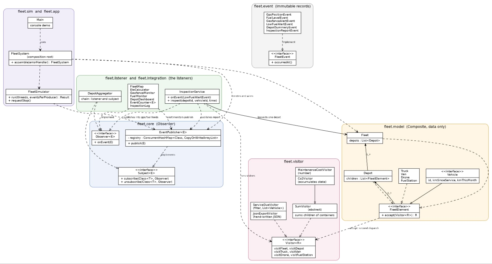

# Fleet Logistics: Observer and Visitor (SDP Assignment 6, variant 6)

Student: Ingkar Tolegen

Group: SE-2540

A fleet of trucks, vans and drones sends live GPS positions and fuel readings (Observer). Operations on the fleet tree, such as maintenance cost, CO2 report, service list and JSON export, are added as visitors without touching the tree classes (Visitor). An alert starts a visitor on the depot that raised it, and the answer returns as a new event.

## Build and run

```
mvn test
mvn compile exec:java "-Dexec.mainClass=fleet.app.Main"
```

`mvn test` runs all tests and writes the coverage report to `target/site/jacoco/index.html`.

Demo menu:

| Option | What it shows |
|---|---|
| 1 | Runs the simulation with the chosen number of producer threads and events per thread, then prints published and received counts |
| 2 | Depot dashboard, fed by the aggregator (chain of observers) |
| 3 | Last position and ETA to the depot for every vehicle |
| 4 | Inspection reports (alert, visitors on the depot, report event) |
| 5 | Visitor reports: maintenance cost, CO2 total and per depot, vehicles due for service |
| 6 | The whole fleet as JSON |
| 7 | Switches a live alert printer on or off: a listener joins and leaves at runtime |
| 8 | Reset: builds a new empty system |

The system keeps no files and no database. To start from a clean state, use option 8 or restart the program.

## UML class diagram



## Observer

**Own generic interfaces.** `Observer<E>` has one method `onEvent(E)`. `Subject<E>` has `subscribe(Class<T>, Observer<? super T>)` and `unsubscribe(...)`. `EventPublisher<E>` implements `Subject<E>` and adds `publish(E)`. `java.util.Observable` and event libraries are not used.

**Event type is the event class.** Events are immutable records (`GpsPositionEvent`, `FuelLevelEvent`, `GeofenceAlertEvent`, `LowFuelAlertEvent`, `DepotSummaryEvent`, `InspectionReportEvent`). A listener subscribes with the class, for example `subscribe(GpsPositionEvent.class, map)`. The listener receives the exact type, so there is no `instanceof` and no cast in any listener.

**Data sources (subjects).** Two feeds are filled by the simulator: the GPS feed and the fuel feed. Two more subjects carry derived data: the alert feed (written by the geofence and fuel monitors) and the report feed (written by the inspection service).

**Listeners.**

| Listener | Listens to | Does |
|---|---|---|
| `FleetMap` | GPS | keeps the last position of each vehicle |
| `EtaCalculator` | GPS | minutes to the depot at the current speed |
| `GeofenceMonitor` | GPS | one alert when a vehicle leaves the radius around its depot |
| `FuelMonitor` | fuel | alert when the level is below the threshold |
| `DepotAggregator` | GPS | listener and subject: publishes an average-speed summary after every window of readings |
| `DepotDashboard` | summaries | shows the latest summary per depot (the second link of the chain) |
| `InspectionService` | low fuel alerts | starts visitors on the depot and publishes a report |
| `InspectionLog`, `EventCounter<E>` | reports, any type | store reports, count events |

**Chain of observers.** `DepotAggregator` implements both `Observer` and `Subject`. The dashboard subscribes to the aggregator, not to the sensors.

**Join and leave at runtime.** The registry is a `ConcurrentHashMap` from event class to `CopyOnWriteArrayList`. `publish` iterates over a snapshot of the list. Because of this, an observer can unsubscribe itself, or subscribe another observer, inside its own handler, and other threads can subscribe or unsubscribe while events are published. Nothing is locked and no `ConcurrentModificationException` can happen. Subscribing the same observer twice has no effect. A listener that throws is reported to an error handler and does not stop the other listeners. These cases are covered in `EventPublisherTest`.

**Push, not pull.** The event carries all the data. Listeners run in several producer threads, and the event is an immutable snapshot, so a listener never reads shared mutable state and there is no race between the notification and the read. With pull, every listener would have to ask the source for data later, and the source could already have changed.

## Visitor

**Tree.** `Fleet` (container) contains `Depot` (container), which contains `Truck`, `Van`, `Drone` and `FuelStation` (four leaf types). That is three levels, two container types and four leaf types. Records hold data only. Their only method is `accept`, one line that calls the right `visitXxx` method.

**Double dispatch.** The client cannot call `visitor.visit(node)` on a `FleetElement`: Java picks the overload by the static type, which is `FleetElement`, and not by the real type. `node.accept(visitor)` is the first dispatch (it selects the element class at runtime). Inside, `visitor.visitTruck(this)` is the second dispatch (the compiler knows the type is `Truck` there). `DoubleDispatchTest` shows it.

**The visitor traverses the tree, not the tree.** A container's `accept` calls one visit method, and the visitor decides what to do with the children. Different operations need different traversal: the JSON export writes brackets and commas around the children, the filter collects lists, the CO2 visitor records a total per depot. If the tree did the traversal, every visitor would get the same fixed order and could not control it. The price is that every visitor repeats a small loop. `SumVisitor` removes this repetition for the visitors that add numbers.

**Four visitors.**

| Visitor | Kind | Result |
|---|---|---|
| `MaintenanceCostVisitor` | numeric calculation | kilometres since service times a rate per vehicle kind |
| `Co2Visitor` | accumulates state across the tree | monthly CO2 total and CO2 per depot (one instance per traversal) |
| `ServiceDueVisitor` | filter | list of vehicles that drove at least the threshold since their last service |
| `JsonExportVisitor` | hand-written JSON | nested output, quotes escaped, no library |

**Hand-calculated checks.** The sample tree has depot D1 with truck T1 (12 000 km since service), van V1 (3 000 km) and a station, and depot D2 with drone DR1 (500 km) and truck T2 (9 000 km). Maintenance cost of D1 is 12 000 × 0.30 + 3 000 × 0.20 = 4 200. D2 is 500 × 0.05 + 9 000 × 0.30 = 2 725. The fleet is 6 925. These numbers are asserted in `MaintenanceCostVisitorTest`. CO2 is checked the same way in `Co2VisitorTest` (diesel 2.68 kg per litre, 0.5 kg per kWh): 804 + 134 for D1, 5 + 536 for D2, 1 479 kg in total.

## Integration: Observer and Visitor together

Low fuel reading, `FuelMonitor` raises `LowFuelAlertEvent`, `InspectionService` finds the depot of the alerting vehicle and runs `MaintenanceCostVisitor` and `ServiceDueVisitor` on that depot only. The answer is published as `InspectionReportEvent` and stored by `InspectionLog`. A test checks that an alert in depot D2 gives the cost of D2 (2 725) and not of the whole fleet (6 925). `PipelineTest` runs the whole chain from the sensor to the log. The service keeps no state between calls, and the fleet is immutable, so alerts from many threads are safe.

## Concurrency

`FleetSimulator.run(producerThreads, eventsPerProducer)` starts the producers on an `ExecutorService`. The thread count is a parameter (at least 1). Events are delivered inside the producer thread, so when `invokeAll` returns, every published event has been handled by every listener, and no queue can lose events. Shutdown happens in `finally`: `shutdown()`, wait up to 5 seconds, then `shutdownNow()`. `requestStop()` lets the producers finish the event they are publishing and stop. Producer threads have the names `fleet-producer-N`, and a test checks that none is alive after a run.

Shared state is thread-safe without locking a whole subject: concurrent maps, copy-on-write listener lists, atomic counters, and one small lock per depot inside `DepotAggregator`, so depots never block each other.

**Stress test.** Four threads publish 1 000 events each. Exact expected values: 4 000 GPS events and 4 000 fuel readings received, 4 vehicles on the map, 40 summaries with a window of 100 (two depots, 2 000 events each). The same exact count is checked on the real composition root in `FleetSystemTest`: 4 000 events and 400 summaries with a window of 10.

## Clean Code

- **One composition root.** `FleetSystem.assemble(...)` is the only place that creates and connects objects. `Main` only uses it.
- **Constructor injection only.** Every class receives its collaborators (feeds, depots, thresholds, error handler) through its constructor. There are no singletons, no static mutable state and no lazy initialization in business code. Every `assemble` call gives an independent system (tested).
- **No duplication.** `SumVisitor` holds the shared summing loops, `EventCounter<E>` is one generic class used for six counters, `GeoPoint` has the only distance formula.
- **Small classes with one reason.** Each listener has one job. Failing listeners are isolated by the publisher, not by each listener.

## Tests

More than 70 JUnit 5 tests. Main groups:

- `EventPublisherTest`: delivery by type, order, unsubscribe, double subscribe, unsubscribe and subscribe inside a handler, failing listener, publishing while others join and leave in other threads.
- Listener tests: map, ETA, geofence (one alert per exit), fuel, aggregator chain, counter.
- Visitor tests with hand-calculated values, `DoubleDispatchTest`, JSON nesting and escaping.
- Integration: `InspectionServiceTest`, `PipelineTest`, `FleetSystemTest`.
- Concurrency: `FleetSimulatorTest` (configurable threads, stop without lost events, no thread leak, same seed gives the same events) and `StressTest` (4 × 1 000).

## Git history

The repository was built step by step, with tests committed together with the code they test: Observer core, listeners, Visitor tree and visitors, integration, concurrency, composition root with demo, README and diagram.
>> 
>> ## Trade-off proof: the price of each kind of change
>> 
>> Two separate commits show what Visitor makes cheap and what it makes expensive.
>> 
>> **Commit A, "Add FuelCostVisitor (new visitor, no element class touched)".**
>> 
>> | File | Change |
>> |---|---|
>> | `visitor/FuelCostVisitor.java` | new |
>> | `visitor/FuelCostVisitorTest.java` | new |
>> 
>> No existing file changed. All element classes and the `Visitor` interface stay exactly as they were. The cost of a new operation is one class and its test.
>> 
>> **Commit B, "Add Trailer element type".**
>> 
>> | File | Change |
>> |---|---|
>> | `model/Trailer.java` | new element |
>> | `visitor/Visitor.java` | new method `visitTrailer` |
>> | `visitor/MaintenanceCostVisitor.java` | new method (rate 0.10) |
>> | `visitor/Co2Visitor.java` | new method (no emissions) |
>> | `visitor/FuelCostVisitor.java` | new method (burns nothing) |
>> | `visitor/ServiceDueVisitor.java` | new method |
>> | `visitor/JsonExportVisitor.java` | new method, common vehicle fields moved to one helper |
>> | `DoubleDispatchTest.java` | the test visitor needs the new method |
>> | `TrailerVisitorTest.java` | new tests |
>> 
>> Nine files: two new and seven changed. The cost of a new element type is one new method in the interface and in every visitor, so with N visitors it touches N + 1 existing files. The compiler forces this: a visitor that misses the new method does not compile, so a forgotten case is never a silent bug.
>> 
>> **When I would reject Visitor.** Visitor is cheap when the tree is stable and operations keep arriving, as in this fleet: the element kinds change rarely, and new reports are often needed. If new element types appeared every week and there were many visitors, every new element would touch all of them. Then I would put the operations into the element classes (ordinary polymorphism) or use sealed types with pattern matching.
